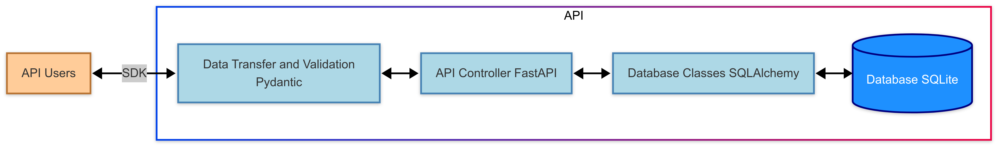

# CinéData — Phase 1 : API et SDK MovieLens

Projet personnel en deux dépôts, autour du jeu de données MovieLens :

| Phase | Dépôt | Contenu |
|---|---|---|
| **1. API et SDK** | **ce dépôt** | Base SQLite, API REST FastAPI, SDK Python publié sur PyPI |
| 2. Analyse et application | [Movies-Analytics](https://github.com/soboure69/Movies-Analytics) | Notebooks d'analyse et application Streamlit qui interroge cette API via le SDK |

**En ligne**

- API : <https://movie-backend-x8iq.onrender.com> · documentation interactive : [`/docs`](https://movie-backend-x8iq.onrender.com/docs)
- SDK : [`films-sdk-sbre` sur PyPI](https://pypi.org/project/films-sdk-sbre/)
- Application qui utilise l'API : <https://movies-analytics-by-soboure-bello.streamlit.app/>

L'API est hébergée sur l'offre gratuite de Render : après une période sans visite, le premier appel la réveille en 30 à 60 secondes.



## Ce que j'ai construit

1. **Données.** Les quatre fichiers MovieLens `ml-latest-small` (GroupLens) : 9 742 films, 100 836 notes et 3 683 tags donnés par 610 utilisateurs, et 9 742 liens vers IMDb et TMDb. Ils sont chargés dans une base SQLite (`api/movies.db`) décrite par quatre modèles SQLAlchemy : `movies`, `ratings`, `tags`, `links`.
2. **API REST (FastAPI).** Onze points d'accès en lecture, documentés dans Swagger :

   | Point d'accès | Rôle |
   |---|---|
   | `GET /` | État de l'API |
   | `GET /movies`, `GET /movies/{movie_id}` | Films, avec pagination (`skip`, `limit` ≤ 1 000) et filtres par titre ou genre ; un film avec ses notes et ses tags |
   | `GET /ratings`, `GET /ratings/{user_id}/{movie_id}` | Notes |
   | `GET /tags`, `GET /tags/{user_id}/{movie_id}/{tag_text}` | Tags |
   | `GET /links`, `GET /links/{movie_id}` | Identifiants IMDb et TMDb |
   | `GET /analytics` | Nombre de films, de notes, de tags et de liens |

   Les réponses sont validées par des schémas Pydantic. Les requêtes sont regroupées dans `api/query_helpers.py`.
3. **SDK Python (`films_sdk_sbre`).** Un client `MovieClient` qui couvre tous les points d'accès et renvoie, au choix, des objets Pydantic, des dictionnaires ou un `DataFrame` pandas. Publié sur PyPI par GitHub Actions (`.github/workflows/python-publish.yml`), avec la publication de confiance de PyPI : aucun jeton n'est stocké dans le dépôt.
4. **Déploiement.** Image Docker (`python:3.13-slim`, `api/Dockerfile`) déployée sur Render.

## Utiliser l'API

Avec le SDK (Python 3.13 ou plus récent) :

```bash
pip install films_sdk_sbre
```

```python
from films_sdk_sbre import MovieClient, MovieConfig

client = MovieClient(MovieConfig(movie_base_url="https://movie-backend-x8iq.onrender.com"))
client.get_movie(1)                                  # Toy Story (1995), avec ses notes et ses tags
films = client.list_movies(genre="Comedy", limit=50, output_format="pandas")
```

Ou directement : `curl https://movie-backend-x8iq.onrender.com/movies/1`.

## Lancer l'API en local

```bash
cd api
python -m venv .venv
.venv\Scripts\activate          # Windows ; source .venv/bin/activate sous Linux ou macOS
pip install -r requirements.txt
uvicorn main:app --reload        # puis http://127.0.0.1:8000/docs
```

Ou avec Docker : `docker build -t movie-api api && docker run -p 8000:80 movie-api`.

## Tests

31 tests `pytest` (`api/tests/`) vérifient chaque point d'accès avec le client de test de FastAPI, sur la base `movies.db` du dépôt et sans serveur : contenu des réponses, pagination, filtres, erreurs 404 et 422. Ils tournent à chaque poussée dans GitHub Actions (`.github/workflows/tests.yml`).

```bash
cd api
pip install -r requirements.txt pytest
pytest -q
```

En les écrivant, j'ai trouvé et corrigé deux défauts :

- **une limite négative contournait le plafond de 1 000 lignes** : avec SQLite, `limit=-1` veut dire « sans limite », et `/ratings?limit=-1` renvoyait les 100 836 notes. `limit` doit maintenant valoir entre 1 et 1 000 ;
- **huit films sans identifiant TMDb provoquaient une erreur 500** (par exemple `/links/791`), car la base stocke une chaîne vide. L'API renvoie maintenant `"tmdbId": null`.

Les anciens scripts `api/test_models.py` et `api/test_query_helpers.py` sont des vérifications manuelles, exclues de `pytest` par `api/pytest.ini`.

## Limites

- L'API est en lecture seule et sans authentification : elle sert un jeu de données public.
- La base SQLite est embarquée dans l'image. C'est simple à déployer, mais ce n'est pas fait pour des écritures concurrentes.
- Les tests couvrent l'API, pas le SDK : `sdk/test_sdk.py` reste un script de vérification manuelle qui appelle l'API en ligne.
- Le SDK demande Python 3.13 ou plus récent. Les options de nouvelle tentative (`backoff`) de `MovieConfig` sont déclarées mais pas encore appliquées par le client.
- L'hébergement gratuit met l'API en veille après inactivité.

## Documentation détaillée

- [`Rapport.md`](Rapport.md) : journal de construction, étape par étape.
- [`api/README.md`](api/README.md) et [`sdk/README.md`](sdk/README.md) : détails de l'API et du SDK.
- [`docs/notes_de_travail.md`](docs/notes_de_travail.md) : notes de cadrage du projet (ancienne version de ce README).

## Données et licence

Données : [MovieLens `ml-latest-small`](https://grouplens.org/datasets/movielens/) (GroupLens, université du Minnesota), redistribuées dans les conditions de leur licence (voir `data/README.txt`).

Licence du code : MIT (voir [`LICENSE`](LICENSE)).
